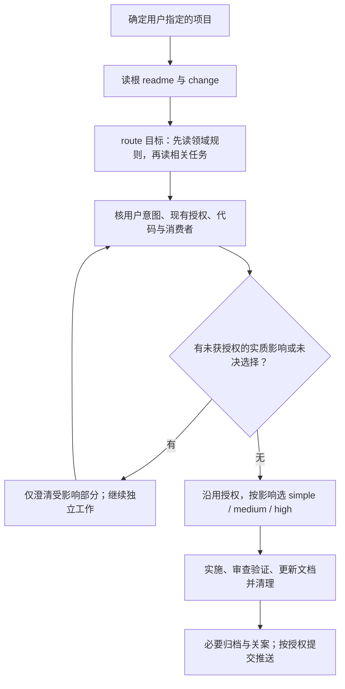

# Recall

从项目文档恢复现行规则、用户意图和未完任务，再按影响实施与交付。维护技能时用技能源项目；使用技能时用用户指定的消费项目。消费项目的规则与一次性授权留在该项目，不复制到技能入口。

## 快速路径

下图是操作导航，规则定义见[根规则](logic_readme.md)及其领域目录；授权判断见[任务交付 RULE-025](logic_domains/task-workflow/logic_readme.md)，字段不提供执行权限。

环境明确要求审批或拒绝某项操作时，按 RULE-025 处理该操作；不把每个步骤都变成用户确认点。接手/压缩不重置原授权。

## 定位与读取

1. 确认目标项目：用户指定优先，当前目录和同名文件只作线索；实质歧义先只读调查再澄清。根 readme 缺失时按[项目接入](references/project-onboarding.md)处理。
2. 完整读目标根 `logic_readme.md`，再读根 `logic_change.md`。接手/选择任务时用 `recall next [--json]`，核需求来源、剩余动作和证据时点。
3. 在目标根运行 `recall route <任务ID、路径、关键词或 INT-ID>`，先读命中领域 readme，再读本任务及必要相关议案；其他任务先看摘要，旧领域 change 兼容。路由结果只是阅读范围。
4. 核受影响代码、真实消费者、测试及必要运行证据。历史仅在任务明确要求时按 ID 读，现行链接不触发历史读取（RULE-003）。

命令显式设置 cwd。目录不清用 `inventory`，输出前用 `path` 核根相对路径；临时物放项目 scratch_root，详见[工作路径与任务](references/workspace-tasks.md)。CLI 不可用时保持读取顺序，如实记录未执行检查及影响。

## 按影响选择深度

| 通道 | 适用 | 必要工作 |
|---|---|---|
| simple | 局部隔离、意图明确，不触 public/persisted/security 契约或活跃案 | 直接改并适度验证；通常无 CHG/VER，按实际影响同步文档 |
| medium | 触契约路径但语义不变，或多文件且无未决长期选择 | 按 RULE-014/020 在任务正文记需求、计划、影响、验证/回滚和产物；规则/行为变化保留精简 VER |
| high | 改对外语义、迁移、安全边界或长期结构 | 核消费者/跨域契约，比较最小修改、结构修改、保持现状；明确迁移/回滚及授权，裁决未决关键选择，保留完整 VER |

治理字段见[治理模式](references/governance-modes.md)；完整表单与 `formal-review` 只用于明确要求的正式审查。

## 实施与交付

- 按 RULE-014/017/025/027 恢复用户来源与原授权；区分想法、已决定待办、本次实施，推断不能冒充已确认意图。需要 CHG 时先找可合并的活跃案，在同正文保全需求三字段、当前计划和简短修订表；承接待办后移除原行。
- 状态变化、实质验证及交接前更新顶部 `status/current_result/next_action`；阻塞写解除动作。规则及地图增量更新，readme 合并成完整现行表述（RULE-002/029）。长期兼容层先核真实消费者、退出条件及回滚。
- 按 RULE-020/025：核 diff → 语义审查/必要验证 → 更新 readme/地图 → 核验并清理 → 需求与修订归同一 VER/index → 关闭 CHG/公报。提前建的 VER 保持关联草稿，清理事实齐备才定稿；定稿只追加。simple 无 CHG 用简短汇报。
- 清理按[逐项核验步骤](references/workspace-tasks.md#核验后逐项删除)沿用授权；每轮处理本轮产物，keep 记依据和退出条件，复用物先晋升。关案用 `workspace --closing CHG-ID` 核实物，列本次结果与全局遗留；旧 logic_temp 兼容，新任务台账在正文。
- 静态通过、源码交付、生产启用分别报告；人工交付后新问题另开案，简单修复仍 simple。Git 操作按[Git 管道 RULE-010/011/013](logic_domains/git-pipeline/logic_readme.md)。

## 命令与按需参考

Windows 用维护源 `recall.bat`，Linux/macOS 用 `recall.sh`；在目标项目根调用，需 Python 3.11+ 和完整 scripts/。

| 目的 | 命令 |
|---|---|
| 接手/阅读 | `recall next --json`、`recall route <目标>`、`recall status` |
| 公报核对/更新 | `recall index`（差异退出 1）；显式更新用 `index --write` |
| 路径/地图 | `recall path <相对路径>`、`recall inventory [目录]`；更新地图用 `inventory --write` |
| 产物核对 | `recall workspace --task CHG-ID [--round 01]`、`workspace --closing CHG-ID` |
| 一致性/静态门 | `recall validate`、`recall audit`；正式审查才加 `--formal-review` |

上表仅两个 `--write` 写派生文档，其余只读；不删除、不推送。

| 需要处理 | 读取 |
|---|---|
| 待办、接手、授权判断 | [任务上下文](references/task-context.md) |
| 路径、产物、修订与清理 | [工作路径与任务](references/workspace-tasks.md) |
| 晋升、归档、关案 | [生命周期](references/change-lifecycle.md) |
| 创建、拆分、压缩文档 | [文档模型](references/document-model.md)、[领域模板](references/logic-domain-template.md) |
| 字段与记录 | [字段词汇](references/field-vocabulary.md)、[CHG](references/logic-change-template.md)、[VER](references/logic-version-template.md)、[台账](references/logic-temp-template.md) |
| 接入与实际用法 | [项目接入](references/project-onboarding.md)、[三个示例](references/practical-examples.md)、[Git同步](references/git-sync.md) |
| Plan/Spec/Steering 或展示 | [外部工作流](references/workflow-integration.md)、[explainers](references/explainers.md) |
