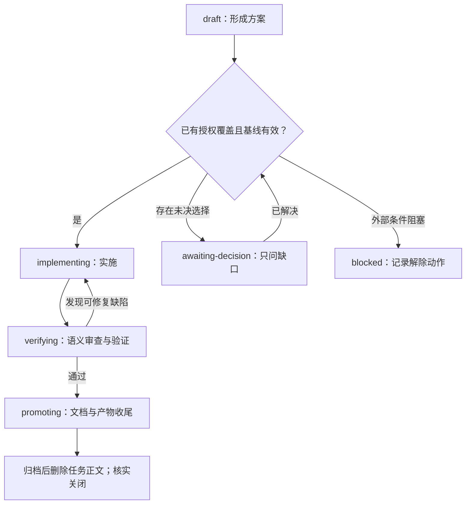

# 变更与决策生命周期

规则见[任务交付 RULE-025/027](../logic_domains/task-workflow/logic_readme.md)，字段见[CHG 最小块](logic-change-template.md#personal-最小块)。本文只维护一条实施与收尾路径。simple 通常无需 CHG/VER；已有 CHG 的任务结束时保全简短需求、修订和结论，再删除任务正文。

## 状态机

任何阶段出现实际阻塞，只暂停受影响部分，继续独立工作；解除后重核基线并回到未完成步骤。仅真实未决选择进入 `awaiting-decision`，换轮、修订号变化或接手不自动触发确认。平台审批在具体操作需要时处理，见[授权判断](task-context.md#授权判断示例)。

## 实施前

1. **承接需求**：先查 `next`。能统一目标、验收和收尾就并入原 CHG；需要独立发布/回滚或授权冲突才分案。待办与合并方法见[工作路径与任务](workspace-tasks.md#一项任务一个正文)。新任务放 `logic_changes/任务/logic_change.md`，用 scope/affected_scopes 关联领域，根公报由 `index --write` 派生。
2. **记录已有授权**：按治理模式填写来源、日期、确认方及适用版本；当前请求已给出决定就直接记录。确有新选择才询问，字段不是权限。方案、影响面、基线或协调关系实变才增加 `proposal_revision`；仍在原授权内则核对并对齐适用版本后继续。
3. **核基线和影响**：按实际需要记录 `based_on`、精确 `authority_surfaces`、依赖/冲突、消费者、运行暴露、`docs_impact`、验证与回滚。实施和晋升前重核同一影响面的活跃案及依赖版本；客观事实先调查，真正缺口按 RULE-025 处理。personal 条件字段缺则不查、写则照查（RULE-023）。

medium/high 在实施前保全 `raw_request/decomposition/fit_analysis`。需要留档时可用 `recall new` 预留 ID；早建 VER 以相同 CHG/revision/slug 关联，保持 `immutable: false`，尚未归档。未开始且未获实施授权的想法仍放待办，不制造实施流程。

## 实施与验证

- 实施获授权且基线有效的方案，记录实际环境与开关暴露。状态变化、实质验证及交接前更新同一正文顶部 `status/current_result/next_action`；有意义的修订写一张表，不复制逐轮计划或工具日志。
- 对当前改动、调用方、Schema、测试和运行证据做语义审查；用户确认或静态门通过不能替代。personal 可写一行“AI 审查 passed；范围；命令与结果；未验证环境”，不要求额外人工签字。协作/正式审查按[治理模式](governance-modes.md)保留要求的分工与证据。
- 缺陷继续修复并复验；验证深度随影响选择，文案调整不制造无关测试。无法继续时记证据、影响、责任方、解除动作和复查条件。
- 审查与必要验证通过、无未决设计或实质阻塞后进入 `promoting`，继续下列收尾；源码交付、静态通过、生产启用分别报告。若上线本身是任务目标，仍须完成获授权发布或说明真实外部前置。

## 晋升与关案

`promoting` 是支持中断恢复的过渡态；在同一 CHG 使用下面一份清单，不再维护另一套收尾步骤。

| 顺序 | 操作 | 完成证据 |
|---|---|---|
| 1. 更新现行文档 | 增量合并所属 readme，删除被替代规则，核地图、意图和范围；明确已验证环境及未上线限制 | 现行文档能独立说明行为；关键规则链接本次 VER/ADR；根索引最近 3 条移出前核反链 |
| 2. 安置与清理产物 | 按[产物去向](workspace-tasks.md#完成时的产物去向)处理：必要材料放正式位置并核消费者；删除本任务临时脚本、输出、缓存及空目录 | `workspace --closing CHG-ID` 核实物，pending/delete 已处理，keep 有用途和退出条件；全局遗留另列 |
| 3. 保全并定稿 | 将需求、修订与验证/清理事实归入同一 VER，核内容及引用后定稿，登记历史索引 | 采用下节保全要求；不逐轮建档，不复制整个工作目录 |
| 4. 删除任务正文 | 先核归档身份及完整性，再按[逐项删除](workspace-tasks.md#核验后逐项删除)移除本任务正文和空目录；旧混合账本只删对应条目 | 文件实际消失；其他任务及现行文档未受影响。不能只标“完成”仍留在活跃发现范围 |
| 5. 核实退出 | `index --write` 更新公报，再核 `index`、`next` 和 `workspace`；有按需维护的地图则移除已删除路径 | 本任务已退出活跃列表，临时物无残留；必要材料仍可用。命令不会替代理删除 |

清理限制必须写实：业务已完成而产物仍待处置时报告“业务完成，清理未完成”，继续原任务的可做收尾；不能靠忽略文件、改名 archive、整目录搬家或新建清理报告代替处置。已归档独立正文确实删除受阻时，才按[集中待清理出口](workspace-tasks.md#删除受阻的集中待清理)保全并持续提示，不适用于业务数据或整个任务目录。

simple 无 CHG 时也处理本次临时物，结果简记在交付中。Git 提交/推送按已有授权及[Git 操作说明](git-sync.md)执行，发布前核文件范围和 hook；不能把本地提交写成已推送。

### 归档保全

- `history_retention: compact` 使用精简记录，`full` 或决策检查点保留完整记录；已有 CHG 必有一份结束记录。ADR 仅长期跨范围约束需要时建立。
- `raw_request/decomposition/fit_analysis`、最终 `intent_traceability` 和精简修订表从 CHG 原样搬入；逐项核轮次、日期、最终方案版本、原因、文件与结果。合并任务保留 `merged_from`、各来源与原修订事实；旧案缺失如实说明，不补造。
- 归档相对链接调整到新位置；被删除的临时证据提炼为必要结论，不能只留失效路径。保留实际失败、舍弃方案和必要理由，不保存原始对话或整份过程快照。
- 取消/否决同样保全已有修改和结束原因；落选方案随胜出记录留理由，独立落选 CHG 使用 `status: rejected` 精简 VER 并保全三字段。回滚先让 readme 反映实际状态，再记录恢复结论和限制。
- 关闭主题最后一个 CHG 时，保全四个 `topic_*` 字段：共享背景、约束、稳定讨论来源与最终结论。TOPIC 只组织活跃讨论，不产生第二套规则；协作模式追加已核控制证据与执行引用。
- 清理事实齐备后才设 `immutable: true`；定稿后不追加清理经过或改语义。受管理 after_commit 回填及后续纠正见[Git 追溯](git-sync.md#决策记录的-after_commit-回填)。

## 中断恢复与后续反馈

接手 `promoting` 时读同一清单并核实际文件，继续未完成项；已交付实现不重复执行。草稿补齐事实后定稿，已定稿记录只核对，纠正另建记录。

旧 `verifying` 项逐项核实现与证据：满足条件就完成收尾；必要验证失败、缺陷、未完实现或明确授权前置继续处理。仅未要求的人工体验不制造等待队列；依赖关闭后重核并改绑正式 VER/现行规则，不因上游条目消失便认定完成。

交付后新问题需要立案时开新 CHG，引用原 VER 与复现证据；简单修复仍走 simple。示例见[三个操作示例](practical-examples.md)。
